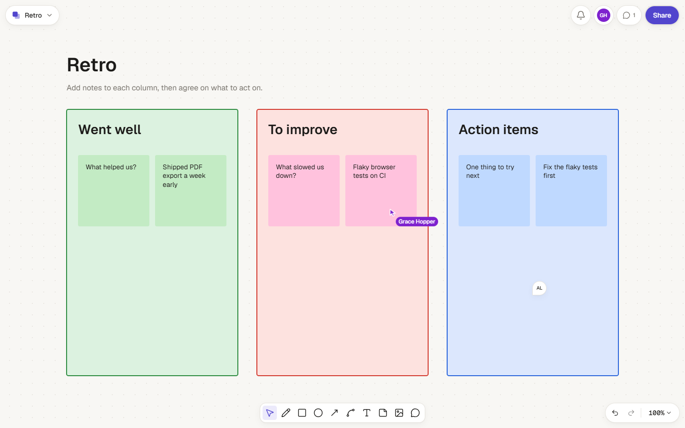
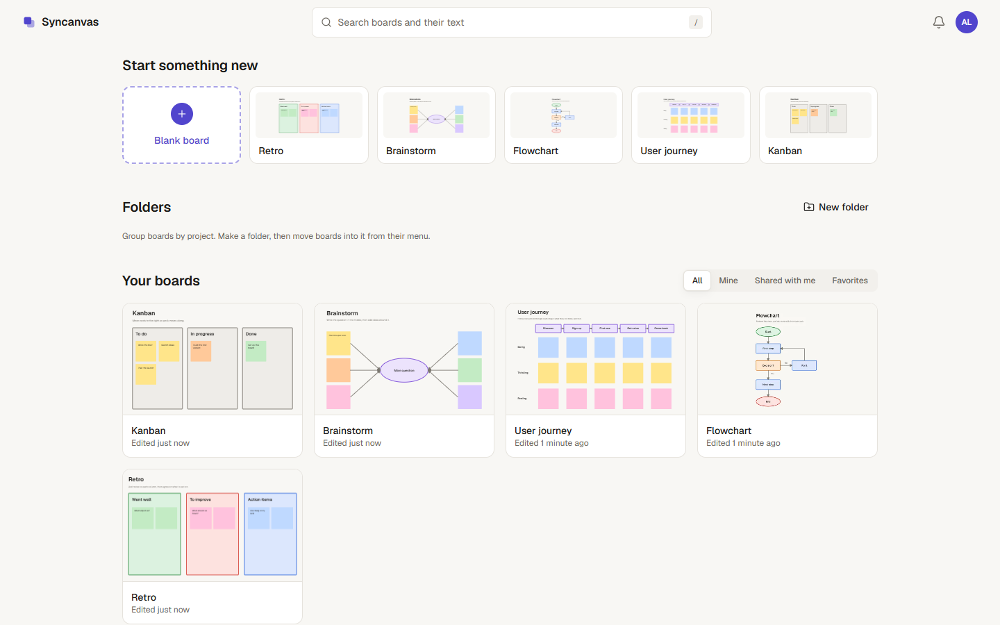
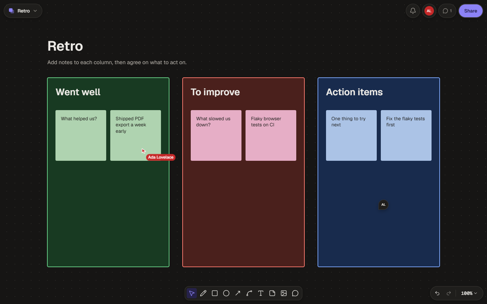
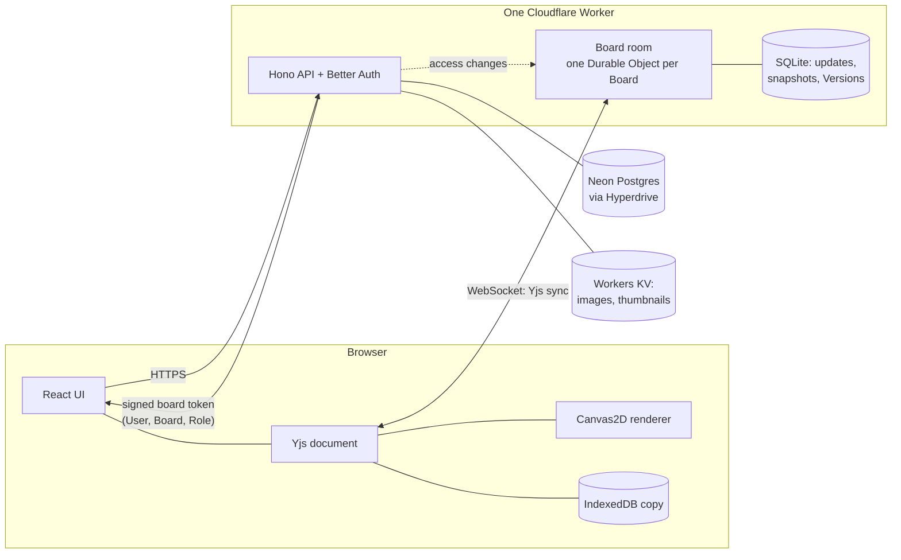

# Syncanvas

[](https://github.com/babarshahzad2005/syncanvas/actions/workflows/ci.yml)

A real-time collaborative whiteboard. Sketch, write, and comment on one shared Board with your team: edits appear for everyone within milliseconds, keep working offline, and merge cleanly when you reconnect, and the server decides who may change what.

**Live:** https://syncanvas.babarshahzad2005.workers.dev · **Engineering write-up:** [`docs/write-up.md`](docs/write-up.md)



## What it does

- **An infinite canvas:** pen, rectangles, ellipses, arrows, connectors that follow the shapes they join, text, sticky notes, and images. Select, group, align, layer, lock, copy and paste (also into other apps as a picture). Undo only undoes *your* changes.
- **Live together:** named cursors, a presence list, follow mode, and who has what selected.
- **Offline first:** a Board opens from a copy saved on your device, keeps working without a connection, and merges with everyone else's edits on reconnect.
- **Real access control:** Owner, Editor, Commenter, and Viewer Roles, through email invitations or a Share Link; signed-out visitors join as Guests. A Role change reaches open connections at once.
- **Comments:** threads pinned to an Element or a spot, mentions, replies, resolve and reopen, in-app notifications, and an email digest.
- **Dashboard:** your Boards and shared ones, folders, favorites, Trash, search through Board text, and five starter templates.
- **History:** Versions you can preview and restore (restoring is itself a reversible edit).
- **Export and Embed:** PNG, SVG, and PDF exports, and a live read-only Embed for other websites.

| Dashboard | Dark mode |
|---|---|
|  |  |

## How it works



- **The Board is a CRDT** ([Yjs](https://yjs.dev)), so concurrent edits merge without conflicts. Each Element's position and size are stored as one value, so a moved shape never ends up half in one place and half in another ([ADR 0002](docs/adr/0002-atomic-geometry-in-the-crdt.md)).
- **Each Board has one board room**, a Durable Object that holds the live document, fans edits out over WebSockets, and stores them in its own SQLite database. It checks every incoming edit: the sender's Role must allow it, and the edit must leave the Board valid. Anything else is refused before it's stored or sent on ([ADR 0006](docs/adr/0006-hand-rolled-board-room-sync.md)).
- **Postgres holds identity, access, and comments.** The API and the board room meet in a short-lived signed **board token**; when someone's access changes, the API tells the room, which downgrades or closes their connections immediately.
- **Everything runs on free tiers** (Cloudflare Workers, Durable Objects, KV, Neon, Brevo for email), and the design keeps inside their limits ([ADR 0007](docs/adr/0007-zero-cost-services.md)).

All the decisions, with the alternatives weighed, are in [`docs/adr/`](docs/adr/).

## Results

The success targets were set before building, and every one was measured. How each was measured, and on what machine, is in [`docs/benchmarks.md`](docs/benchmarks.md).

| | Target | Result |
|---|---|---|
| **Convergence** | All clients end identical after concurrent and offline edits | ✅ A randomized suite: 100 sessions of 400–500 operations each across 7 simulated clients, with delayed, reordered, and dropped messages and offline periods |
| **No lost work** | An accepted edit is never silently lost | ✅ The same suite, plus reconnect tests |
| **Edit latency** | p95 under 100 ms, same region | ✅ 35 ms with 3 Editors |
| **20 Editors at once** | Latency holds; nobody more than 1 s behind | ⚠️ Under 0.5 s behind at 100 edits/s, even on 5,000-Element Boards; p95 latency about 140 ms. The test laptop itself ran out of CPU at higher rates |
| **Rendering** | 60 fps panning a 5,000-Element Board | ✅ 60 fps at 100%; ⚠️ 48 fps with all 5,000 on screen on a 2017 laptop GPU (from 6.6 fps before the work) |
| **Open time** | Cold under 2 s, warm under 300 ms (10 Mbps, 50 ms) | ⚠️ Warm 0.4 s, cold 3.5 s |
| **Access on the server** | Every forbidden edit refused; access changes apply within 1 s | ✅ Board-room tests run in the real Workers runtime |
| **Export fidelity** | Exports match the screen | ✅ PNG and SVG differ from the canvas by at most 0.02% of pixels across a test Board, light and dark |

## Run it locally

You need Node 24 and pnpm 12, plus free Neon and Cloudflare accounts ([`context/SETUP.md`](context/SETUP.md)).

```sh
pnpm install
cp apps/web/.env.example apps/web/.env              # paste your Neon *dev* branch string
cp apps/worker/.dev.vars.example apps/worker/.dev.vars
pnpm --filter @syncanvas/worker gen:secret          # local sign-in secret (never printed)
pnpm --filter @syncanvas/worker gen:keys            # local board-token keys (never printed)
pnpm --filter @syncanvas/worker db:migrate          # create the tables on the dev branch
pnpm dev                                            # http://localhost:5173
```

Sign in with any email address: locally, the sign-in link is printed in the terminal running `pnpm dev`.

| Command | What it does |
|---|---|
| `pnpm dev` | The app, the Worker, and the board rooms on one local server (port 5173) |
| `pnpm check` | Biome, the typecheck, and every unit and integration test, including the board-room tests in workerd |
| `pnpm e2e` | The Playwright browser tests against `pnpm dev` |
| `pnpm perf` / `pnpm loadtest` | The rendering, open-time, and load measurements ([`docs/benchmarks.md`](docs/benchmarks.md)) |
| `pnpm release` | Builds and deploys to Cloudflare by hand |

**How changes ship:** every pull request runs the checks. The full browser suite runs against a throwaway Neon database branch when a pull request gets the `full-e2e` label. Merging to `main` applies migrations to production and deploys.

## Repository layout

```
apps/web          React app (Vite, TanStack Router and Query, shadcn on Base UI) and the Embed viewer
apps/worker       Cloudflare Worker: Hono API, Better Auth, the BoardRoom Durable Object, cron jobs
packages/         board-model (the Yjs document, its rules and operations), renderer (Canvas2D and SVG), shared types
e2e/              Playwright browser tests
tools/            load test and performance measurements
context/, docs/   product requirements, flows, design system, decisions, benchmarks
```

## License

[MIT](LICENSE)
