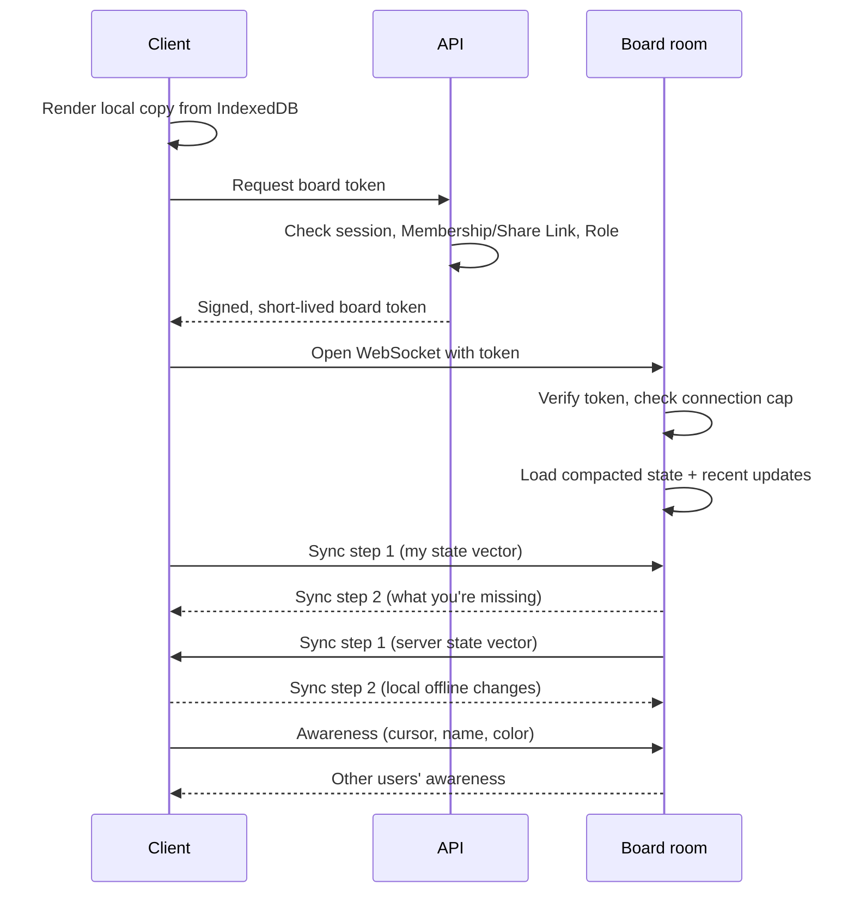

# Core application flows

How Syncanvas behaves, step by step, from signing in to the background jobs nobody sees. These flows match `context/PRD.md`. Domain terms (User, Member, Guest, Element, Thread, …) are defined in `GLOSSARY.md`.

Actors used throughout:

- **Client**: the browser app (React UI, Canvas2D renderer, Yjs doc, IndexedDB)
- **API**: the API worker (Hono on Cloudflare Workers), backed by Postgres (via Hyperdrive) and Workers KV (images, thumbnails)
- **Board room**: one Durable Object per Board, holding the live Yjs doc and its own SQLite storage

---

## 1. Accounts and Boards

### Sign up and sign in

1. The user picks Google or email. Google goes through the OAuth redirect; email sends a one-time sign-in link.
2. On success, the API finds or creates the User by verified email. Both sign-in methods with the same email reach the same User.
3. On a first sign-up, any pending Invitations for that email become Memberships.
4. The API sets an HTTP-only session cookie.
5. The client redirects to the dashboard, or back to the Board link the user originally opened. That matters for people arriving from an Invitation or the Share Link.

### Create a Board

1. From the dashboard, the user clicks "New board" and optionally picks a template.
2. The API checks the quota (50 owned Boards per User), then creates the `boards` row and the `owner` Membership in one transaction and returns the Board ID. If the quota is reached, creation is refused with a clear message.
3. If a template was chosen, the Board gets the template's prebuilt thumbnail. Once connected, the client applies the template's Elements as the first Yjs transaction, so a template is ordinary content.
4. The client navigates to the Board, and the "Open a Board" flow begins.

### Dashboard

1. The client fetches the user's owned Boards, shared Boards, Folders, favorites, recent Boards, and Trash from the API in one request.
2. Folders and favorites are private to the User. Any Board the User can open, owned or shared, can go in one of their Folders (one level, no nesting).
3. Thumbnails load from KV through the API, from the same origin. Boards without one show a placeholder.

### Delete and restore a Board

1. Only the Owner can delete a Board. The API marks it deleted and moves it to the Owner's Trash.
2. The API calls the Board room's internal endpoint, which closes every open connection. Members, Guests, and Embed viewers lose access immediately.
3. For 30 days, the Owner can restore it from Trash with all Members, Threads, and Versions intact. After that, a cleanup job deletes the Board permanently, including its board room storage and its images and thumbnail in KV.

### Leave a Board

1. Any Member except the Owner can leave. The API deletes their Membership and tells the Board room to disconnect their sockets.

### Delete an account

1. The User confirms deletion in settings.
2. Every Board they own is permanently deleted, bypassing Trash, and its connections are closed.
3. Their Memberships on other Boards are removed.
4. Their comments stay, attributed to "Deleted user", so other people's Threads stay readable.
5. Their Notifications, Folders, and favorites are deleted, and the session ends.

---

## 2. Live collaboration

### Open a Board

The most important flow: every live feature depends on it.

1. The client renders its last local copy from IndexedDB right away (target: under 300 ms).
2. The client asks the API for a board token. The API checks the session, the Membership (or the Share Link for a Guest), and the Role.
3. The API returns a signed, short-lived token containing the User ID (or a Guest ID), Board ID, and Role.
4. The client opens a WebSocket to the Board room with the token. The Board room verifies the signature, applies the connection cap, and loads the latest compacted state plus recent updates.
5. Client and Board room run Yjs sync steps 1 and 2 in both directions, exchanging only the changes each side is missing.
6. The client goes live: it publishes its presence and starts sending and receiving edits. On a cold open of a 1,000-Element Board, this should happen in under 2 s.

**Connection cap**

The Board room allows 100 live connections per Board.
- **Members** are always admitted, even if that briefly pushes the Board over the cap.
- **Guests** are admitted next, while there's room.
- **Embed viewers** come last.

Guests and Embed viewers turned away by the cap get a static image of the Board that refreshes every 30 s.

The server never renders anything, so while a Board is at its cap, the Board room asks one connected Editor's client to render a PNG every 30 s. It stores that PNG in its own storage, not KV, and serves it from there.

**Edge cases**

- Access check fails. If the local copy has no unsynced edits, the client clears it and shows "You no longer have access." If it has unsynced edits, the client first follows the revoked-while-offline steps under "Go offline and reconnect".
- Token expires mid-session: the client quietly fetches a new one and reconnects.
- Phone-sized screens open the Board read-only, whatever the user's Role.

### Draw or edit an Element

1. The user drags out a rectangle. The client updates an in-memory preview on every pointer move but doesn't write to Yjs yet.
2. On pointer up, the client checks the Element cap (20,000 per Board). If there's room, it writes the final Element to the Yjs doc in one transaction tagged with the local origin, so one Ctrl+Z removes the whole shape. Position and size are each written as one value (ADR 0002).
3. The renderer redraws the affected region, and the update is saved to IndexedDB.
4. The update goes to the Board room. The Board room checks the sender's Role and the Element cap, then applies the update, appends it to SQLite, and broadcasts it.
5. Other clients apply the update and redraw. Target round trip: p95 under 100 ms.

**Moving existing Elements**: positions are sent at a throttled rate during the drag (about 20 per second), so collaborators see smooth motion instead of a jump at the end. If two people drag the same Element, the last write wins for the whole position, so everyone converges on a position one of them actually chose.

**Groups**: if concurrent deletes leave a group with fewer than 2 Elements, the group dissolves. An Element whose group no longer exists counts as ungrouped.

### Copy and paste

1. Copying puts the selected Elements on the clipboard in Syncanvas format, plus a PNG fallback. Copying is allowed from any Board the user can open.
2. Pasting needs Editor access on the target Board. Pasted Elements get new IDs and are written in one local transaction, at the cursor or viewport center. They count toward the Element cap.
3. Image Elements pasted into another Board reuse the same image key in KV.
4. Pasting an image from outside Syncanvas follows the "Upload an image" flow. Ctrl/Cmd+D duplicates the selection in place, with a small offset.

### Cursors and presence

1. Each client publishes cursor position, name, color, current selection, and viewport through Yjs awareness, throttled to about 30 updates per second. Guests appear as "Guest N".
2. Awareness is never persisted. It disappears when someone disconnects, which keeps the presence list accurate (updated within 2 s).
3. Follow mode reads another Collaborator's viewport from awareness and copies it on every update, until the follower pans or zooms. Guests can follow others, but nobody can follow a Guest.
4. Embed viewers neither publish nor receive awareness.

### Undo and redo

1. Yjs `UndoManager` tracks only transactions with the local origin, so it never undoes someone else's work.
2. Undoing a move on an Element someone else has since deleted does nothing. This is the intended, safe behavior.
3. The undo history lives only in the current tab session and resets on reload or rejoin. To go further back, use Versions.

### Go offline and reconnect

1. The WebSocket drops. The client shows "Offline, changes saved locally" and keeps editing against the local doc and IndexedDB.
2. The client retries with exponential backoff plus jitter, so a server restart doesn't cause everyone to reconnect at once.
3. On reconnect, it fetches a fresh token if needed and reruns sync steps 1 and 2. The CRDT merges everything.
4. **Revoked while offline:** if access was revoked while the user was offline, the Board room rejects the connection.
   - The client explains that the user no longer has access.
   - It offers a one-time PNG/SVG export of their local copy.
   - It then discards the offline edits and clears the local copy.

---

## 3. Sharing and access

### Invite by email

1. The Owner, or an Editor, enters an email and picks a Role. An Editor can only pick their own Role or lower.
2. The API checks the invitation rate limit, creates a pending Invitation, and sends an email via Brevo.
3. **Invitee already has an account:** a Membership is created immediately, and the Board appears on their dashboard.
4. **Invitee has no account:** the Invitation waits and becomes a Membership when that email first signs in, by email link or Google.
5. Invitations expire after 30 days. The Owner sees pending Invitations in the share dialog and can resend or cancel them. Editors can cancel Invitations they sent.

### Share by link

1. Only the Owner manages the Share Link. A Board has at most one. The Owner turns it on, picks its Role, and optionally sets an expiry.
2. The API stores a random, unguessable token in `share_links`. Link format: `/b/{boardId}?s={token}`.
3. Changing the link's Role, or regenerating it, replaces the token, so the old URL stops working.
4. When someone opens it, the API validates the token and expiry.
   - A **signed-in User** becomes a lasting Member with the link's Role. Turning the link off later doesn't remove them.
   - An **anonymous visitor** becomes a Guest with view access only.

### Change or revoke access

1. Only the Owner changes a Member's Role, removes a Member, or turns off the Share Link. The API updates Postgres.
2. The API calls the Board room's internal endpoint, which downgrades or disconnects the affected sockets within 1 s.
3. A downgraded Editor's client switches to read-only. A removed Member is sent back to the dashboard. When the Share Link is turned off, Guests who came through it are disconnected.

Why it matters: without step 2, someone whose access was removed could keep editing until they refreshed.

---

## 4. Comments and Notifications

### Add a comment

1. A Commenter or above picks the comment tool, clicks an Element or an empty spot, and types a message.
2. The API checks the Role and saves the Thread and first comment in Postgres. It stores the attached Element ID, or canvas coordinates.
3. The API notifies the Board room, which broadcasts a "comment added" event. Collaborators see the pin appear live. Embed viewers never receive comment events.
4. Pins are drawn relative to their Element's current position, so they follow it when it moves.
5. If the Element doesn't currently exist, the Thread is a Detached Thread. The client works this out from the Board state; nothing is stored. Its pin stays at the Element's last known position, faded and labeled "detached". If the Element comes back (through undo or a Version restore), the pin snaps back to it.

### Reply, edit, delete

1. Commenters and above can reply to any Thread.
2. Authors can edit and delete their own comments. The Owner can delete any comment or Thread.
3. Viewers and Guests can read Threads but not write.
4. Every change is saved in Postgres and broadcast by the Board room.

### Mentions and reply Notifications

1. If a comment includes `@name`, the API checks that the person is a Member of the Board. Guests can't be mentioned.
2. The API creates a Notification for each mentioned Member. For a reply, it also creates one for everyone who has posted in or been mentioned in the Thread. The author of the reply is never notified of their own reply.
3. If a recipient is online, their in-app badge updates immediately.
4. The bell opens the notification list: the User's Notifications across all Boards, newest first.
   - Clicking one opens the Board with the Thread focused.
   - Notifications can be marked read one at a time or all at once.
   - They're kept for 90 days.
5. If a Notification stays unread, it goes into the next email digest, unless the User has turned digest emails off.

### Resolve a Thread

1. A Commenter or above resolves or reopens any Thread. The API updates its status in Postgres.
2. The Board room broadcasts the change, and the pin hides unless the "show resolved" filter is on.

---

## 5. Content and history

### Upload an image

1. The user drops or pastes an image onto the canvas. The client validates the type (PNG, JPEG, GIF, or WebP; no SVG) and size (5 MB maximum), and shows a placeholder at the drop position.
2. The client uploads the file to the API. The API checks that the user is an Editor and that the upload fits their 50 MB image quota, then stores it in KV and returns its key.
3. The client writes an image Element with that key into Yjs. Animated GIFs show their first frame.
4. KV can take up to about 60 seconds to make a new image visible in other regions. Until then, collaborators elsewhere see a placeholder that retries.
5. If the upload fails, the placeholder shows a retry button instead of disappearing.

### Restore a Version

1. An Editor or the Owner opens Version history. The Board room returns the list of Versions. Commenters and Viewers can't see history.
2. Selecting a Version shows a read-only preview without touching the live Board.
3. On "Restore", the Board room computes the difference between that Version and the current state. It applies the difference as a new change attributed to the person restoring.
4. Everyone sees it as a normal edit, and the restore becomes a new Version, so a mistaken restore can itself be undone.

### Search

1. The user types in the dashboard search box. The API queries the Postgres full-text index over Board titles and Board text.
2. Titles are searchable as soon as they change. Text inside Boards becomes searchable within about 5 minutes, after the next indexing pass.
3. Results include only Boards the user is a Member of, with a snippet of matching text.

### Export

1. The user chooses the whole Board or the current selection, and a format: PNG, SVG, or PDF.
2. The output is built on the client:
   - **PNG:** the renderer draws to an offscreen canvas, using the same drawing code as the screen. PNGs larger than 8,192 px on the longest side are scaled down, with a notice.
   - **SVG:** built from the Board.
   - **PDF:** generated with `jspdf` from the SVG, so text stays sharp.
3. Exports contain Elements only: no comment pins, cursors, or selection outlines.
4. The file downloads directly. No server is involved.

### Embed

1. The Owner turns on the Embed. The API creates a read-only embed token, separate from the Share Link, with no expiry by default, and returns an iframe snippet.
2. The iframe loads a lightweight viewer page that connects to the Board room as an Embed viewer. It gets live Board updates and can't edit, and it shows no Threads, pins, or cursors.
3. If the Board is at its connection cap, the viewer shows a static image that refreshes every 30 s.
4. The Owner can revoke the Embed at any time, which disconnects every Embed viewer. Turning the Share Link on or off doesn't affect it.

---

## 6. Background flows

### Compaction and indexing (inside each Board room)

1. After a set number of updates or minutes, the Board room merges stored updates into one compacted state and deletes the old rows.
2. Some compacted states are kept as Versions: one per hour of activity for the last 30 days, then thinned to one per day, kept indefinitely.
3. The Board room extracts all text from the Board and sends it to the API to refresh the search index. Board text becomes searchable within about 5 minutes.

### Thumbnails

1. When an Editor leaves a Board after making changes, the client renders a small image of it and uploads it through the API to KV. To stay within KV's 1,000 free writes per day, a Board's thumbnail is written at most once every 10 minutes.
2. Boards created from a template start with the template's prebuilt thumbnail.
3. Trade-off: the server never renders anything, but thumbnails only refresh when an Editor leaves the Board.

### Email digests

1. A cron trigger runs hourly and finds Users with unread Notifications that haven't been emailed, skipping Users who turned digest emails off.
2. It sends one grouped email per User via Brevo, with a one-click unsubscribe link. It then marks those Notifications as emailed, so nothing is sent twice.

### Cleanup

1. A daily cron job permanently deletes Boards that have been in Trash for more than 30 days, along with their Board room storage and their images and thumbnails in KV.
2. The same job expires Invitations older than 30 days and Notifications older than 90 days.
